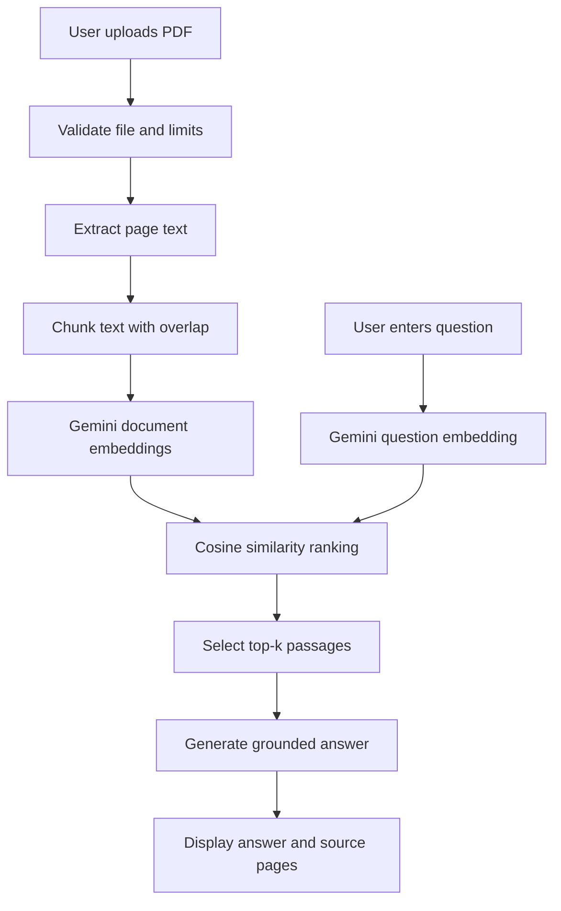
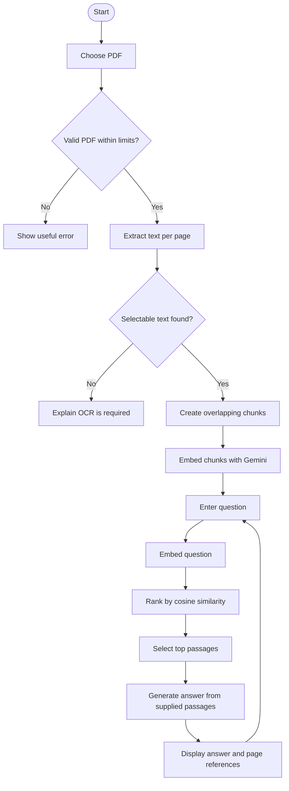

# AI-Based Document Question Answering System Using RAG

## Title page

**Project title:** AI-Based Document Question Answering System Using RAG  
**Submitted by:** [Student name]  
**Roll number:** [Roll number]  
**Institute:** [Institute name]  
**Submission date:** [Submission date]  
**Project guide:** [Guide name, if applicable]

## Abstract

This project demonstrates a web application for asking questions about text-based PDF documents. It extracts text by page, divides that text into overlapping chunks, obtains embeddings using Google's Gemini API, ranks chunks using cosine similarity, and submits the most relevant excerpts to a Gemini generation model. The interface displays an answer and the retrieved source pages. The system illustrates retrieval-augmented generation (RAG), while acknowledging that generated answers are not independently verified. Functionality described here is implemented in the project files; test outcomes should be filled in only after running the tests and recording the results.

## Introduction

PDF reports and manuals can contain more information than a reader can search efficiently. A question-answering interface can make document exploration easier by locating semantically related passages. RAG combines local retrieval with language-model generation: retrieval supplies relevant evidence, and generation forms a readable response from it.

## Problem statement

Users need a simple way to find answers in PDF documents while retaining a connection between responses and their source pages. Keyword search alone may miss passages that express the same idea with different words. This project uses embeddings for semantic matching and cosine similarity for a transparent ranking step.

## Objectives

1. Accept and validate PDF uploads within size and page limits.
2. Extract text with page numbers and create overlapping chunks.
3. Generate compatible Gemini embeddings for chunks and questions.
4. Rank passages with a NumPy cosine-similarity implementation.
5. Generate answers from retrieved passages and display source page references.
6. Provide a clear browser interface, session-level conversation, reset, and understandable errors.

## Scope

The implementation is a local academic demonstration for selectable-text PDFs. It does not include OCR, user accounts, persistent storage, or a production deployment configuration. Document text and questions are sent to Google's Gemini API.

## Requirements

### Hardware (indicative)

- A Windows computer capable of running Python 3.10 or newer.
- Internet connectivity for Gemini API calls.
- Memory and storage sufficient for the selected PDF and Python environment.

### Software

- Windows 10/11 and PowerShell.
- Python 3.10+ (3.11 recommended), pip, and a web browser.
- Flask, google-genai, python-dotenv, PyMuPDF, and NumPy.
- Gemini API key with access to the configured models.

## System architecture

```text
Web browser <-> Flask routes and session state
                    | upload
                    v
          PyMuPDF extraction -> page-aware chunking -> Gemini embedding API
                    question -> Gemini query embedding
                    vectors -> NumPy cosine similarity -> top-k excerpts
                                                     -> Gemini generation API
                    <---------------- answer and source page references
```



## Module descriptions

- **`app.py`:** Flask routes, upload checks, in-memory document mapping, question orchestration, error messages, and reset.
- **`config.py`:** Environment-backed settings and safe integer defaults.
- **`document_processor.py`:** PDF extraction, OCR-needed detection, page-preserving chunking, and overlap.
- **`embeddings.py`:** Official Google GenAI SDK calls for retrieval document/query embeddings and answer generation.
- **`retrieval.py`:** NumPy cosine similarity and top-k ranking.
- **Templates/static files:** Responsive Bootstrap interface, status, history, and feedback.
- **Tests:** Offline checks for chunking and retrieval behavior.

## Algorithm

1. Receive a file and verify its extension, byte length, PDF readability, and page count.
2. Extract selectable text from each page. Reject documents with no extractable text.
3. Normalize whitespace and split each page into bounded chunks with configured overlap. Store chunk IDs and source page numbers.
4. Request an embedding for each chunk using `gemini-embedding-001` and `RETRIEVAL_DOCUMENT` task type.
5. For each question, request an embedding with `RETRIEVAL_QUERY` task type.
6. Compute cosine similarity between the query vector and each chunk vector. Sort descending and retain the configured top-k chunks.
7. Send the question and retrieved excerpts to the generation model with instructions to treat document content as untrusted data and to report insufficient evidence.
8. Display the generated answer and page numbers associated with the retrieved excerpts.

## Flowchart



## Implementation details

Flask keeps each active document in a process-local mapping keyed by a random session document ID. The browser cookie stores the ID, not the PDF text. Uploaded bytes are processed in memory and are not saved to an upload directory. Gemini calls use the official `google-genai` SDK. Application exceptions are logged server-side while users see concise messages. The app has request-size and page limits, and caps each conversation at 30 questions.

## Testing strategy and results template

Automated tests cover text chunking, overlap, empty input, vector cosine similarity, relevant-chunk ordering, and empty retrieval. These tests do not require a Gemini API key.

**Execution record (agent verification):**

- Command: `python -m unittest discover -s tests -v`
- Date/environment: 30 October 2026; Windows, Python 3.15.
- Result: 10 tests passed, including mocked Google GenAI chat answer handling.
- Flask home-page test-client request: HTTP 200; favicon request: HTTP 204.
- Manual browser cases: Not run.
- Gemini API integration check: Not run; no API key was configured.

Unit tests and a home-page response do not verify access to Gemini or the complete browser upload workflow.

## Results

[Insert actual screenshots, observed output, test results, and discussion after running the application. Do not enter simulated results.]

## Limitations

Scanned PDFs require external OCR. PDF layout and tables may not extract in reading order. Embedding calls are sequential and may be slow or limited by API quotas. State is lost when the server restarts and is not shared across worker processes. Gemini can generate incorrect or incomplete responses; citations show retrieved pages rather than proving each statement. The development server and security controls are not suitable for public deployment without further work.

## Future scope

Possible extensions include OCR, efficient batch embedding, encrypted persistent document storage, authentication, improved table extraction, production hosting, and systematic answer-quality evaluation.

## Conclusion

The system demonstrates how document text can be converted into embeddings, searched using cosine similarity, and supplied to a generative model as evidence. It offers an understandable end-to-end RAG workflow and exposes source pages so users can check responses against the original PDF.

## References

1. Google AI for Developers, [Gemini API embeddings guide](https://ai.google.dev/gemini-api/docs/embeddings).
2. Google AI for Developers, [Gemini API chat guide](https://ai.google.dev/gemini-api/docs/text-generation) and [Gemini API models](https://ai.google.dev/gemini-api/docs/models).
3. Google GenAI Python SDK, [official GitHub repository](https://github.com/googleapis/python-genai).
4. Flask Documentation, [Quickstart](https://flask.palletsprojects.com/en/stable/quickstart/).
5. PyMuPDF Documentation, [Text extraction](https://pymupdf.readthedocs.io/en/latest/recipes-text.html).
6. NumPy Documentation, [numpy.dot](https://numpy.org/doc/stable/reference/generated/numpy.dot.html) and [numpy.linalg.norm](https://numpy.org/doc/stable/reference/generated/numpy.linalg.norm.html).
