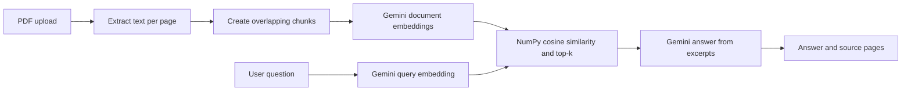

# AI-Based Document Question Answering System

A beginner-friendly Flask demonstration of retrieval-augmented generation (RAG). Upload a text-based PDF, embed its page-aware chunks with Google's Gemini API, rank those chunks using NumPy cosine similarity, and ask Gemini to answer from the retrieved excerpts with page references.

## Problem statement and objectives

Finding a specific fact in a long PDF takes time. This project demonstrates a small pipeline that extracts document text, finds passages semantically related to a question, and generates a response grounded in those passages. It is an academic demonstration and does not guarantee factual accuracy.

## Features

- PDF-only upload, 10 MB maximum, 500-page processing limit, and clear invalid/scanned PDF messages.
- Configurable page-aware chunk size and overlap.
- `gemini-embedding-001` embeddings, cosine ranking, and configurable top-k (default 3).
- Gemini answer generation with untrusted-document prompt instructions and page citations.
- In-memory per-session document state, conversation history, and reset control.
- Responsive Bootstrap interface and automated offline tests.

## Technology stack

Python 3.11 or newer, Flask, official `google-genai` SDK, PyMuPDF, NumPy, python-dotenv, HTML, CSS, and Bootstrap 5. Gemini API usage may be subject to quotas and charges.

## Architecture and workflow

```text
Browser PDF -> Flask upload -> PyMuPDF pages -> overlapping chunks
                                      |                  |
                                      +---- Gemini embeddings
Question -> Gemini query embedding -> NumPy cosine similarity -> top 3 passages
                                                              -> Gemini grounded answer -> Browser
```



## Project structure

```text
document-qa/
├── app.py
├── config.py
├── document_processor.py
├── embeddings.py
├── retrieval.py
├── requirements.txt
├── .env.example
├── .gitignore
├── README.md
├── PROJECT_REPORT.md
├── templates/{base.html,index.html}
├── static/{css/style.css,js/app.js}
└── tests/{test_ajax.py,test_app.py,test_chunking.py,test_embeddings.py,
           test_extraction.py,test_retrieval.py}
```

## Prerequisites and installation (Windows PowerShell)

Install Python 3.11+ and ensure the Python launcher `py` works. In PowerShell:

```powershell
cd $HOME\OneDrive\Desktop\document-qa
py -3.11 -m venv .venv
.\.venv\Scripts\Activate.ps1
python -m pip install --upgrade pip
pip install -r requirements.txt
Copy-Item .env.example .env
```

If PowerShell blocks activation, run `Set-ExecutionPolicy -Scope Process -ExecutionPolicy Bypass` in that terminal, then activate again.

## Gemini API key setup

Create a Gemini API key in Google AI Studio and place it in `.env` as `GEMINI_API_KEY=...`. Set `FLASK_SECRET_KEY` to a long random value. For example, generate one with `python -c "import secrets; print(secrets.token_hex(32))"`. The example uses `gemini-3-flash-preview` with the Google GenAI chat API for generation and `gemini-embedding-001` for embeddings. Model access can vary by API key; if you receive a model unavailable error, choose an available model and set `GEMINI_MODEL` in `.env`. Never share or commit `.env`.

Optional settings in `.env` include `TOP_K`, `CHUNK_SIZE`, `CHUNK_OVERLAP`, `MAX_CONTENT_LENGTH`, and `MAX_PAGES`. Keep overlap smaller than chunk size.

## Run and use

```powershell
python app.py
```

Open `http://127.0.0.1:5000`. Upload a text-based PDF, wait for indexing, enter a question, then review the answer and retrieved source pages. Select **Reset document and conversation** before starting a new document. Stop the server with Ctrl+C.

## Embeddings, RAG, and cosine similarity

An embedding maps text to a numeric vector that represents semantic content. The same embedding model is used for passages and questions. For vectors A and B, cosine similarity is `(A · B) / (||A|| × ||B||)`: it compares vector direction, with values nearer 1 indicating a closer match. Zero vectors and mismatched dimensions receive a safe score of 0. The app selects the highest-scoring passages and gives them to Gemini as context. This retrieval-augmented generation pattern can reduce unsupported answers, but it cannot ensure correctness. The answer is generated, not independently verified.

## Tests and manual checks

Run offline unit tests (no API key required):

```powershell
python -m unittest discover -s tests -v
```

Manual interface cases: upload a normal text PDF and ask a question; upload an image-only scanned PDF; upload a non-PDF or empty file; ask an empty question; test a PDF above 10 MB; reset and confirm prior history is gone; remove or invalidate the API key and confirm a readable error appears. These are suggested checks; only checks actually run by the project author should be reported as results.

## Limitations

- Scanned PDFs need OCR before use. Tables, columns, and unusual layouts can extract poorly.
- Embedding calls are batched but large PDFs may still encounter API quotas.
- The app stores documents and vectors in process memory, so a restart clears them and multiple workers do not share them.
- The random fallback secret invalidates sessions after restart; configure a stable secret for local use.
- This development server is not hardened for internet-facing deployment. It has no authentication, durable storage, or production server configuration.
- Gemini may produce incorrect or incomplete answers even when source pages are shown.

## Privacy and security

Document text and questions are sent to Google's Gemini API for embeddings and answer generation. Review Google's current terms and data handling before uploading sensitive material; API usage may have quotas or charges. Files are not written to disk, and in-process document state is removed on reset or server restart. Sessions use a random document ID and HTTP-only, SameSite cookies. Filename sanitization is only a display safeguard, not proof that file contents are safe. Do not run this app as a public service without a security review.

## Future improvements

OCR support, batched embedding requests, better layout extraction, persistent encrypted storage, authentication, deployment behind a production WSGI server, and answer evaluation against curated questions.

## Conclusion

This project provides a small, inspectable example of PDF extraction, embeddings, cosine-similarity retrieval, and grounded answer generation. Its outputs should be checked against the cited source pages.
